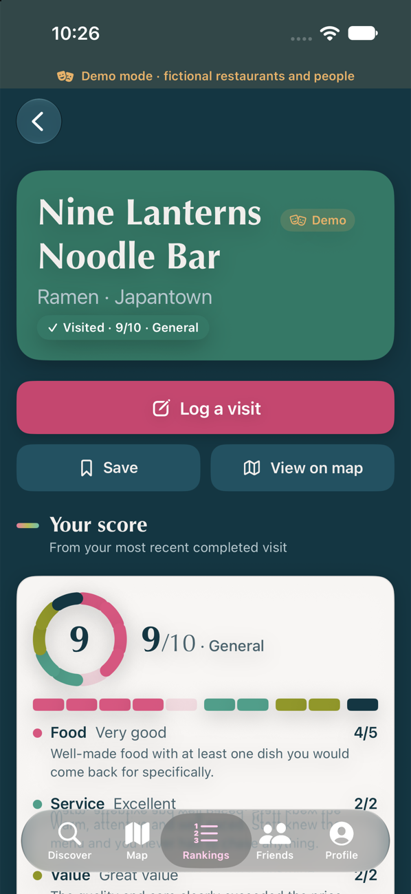
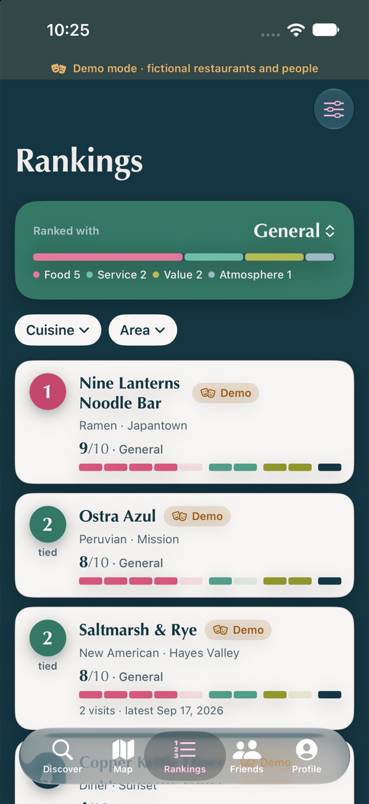
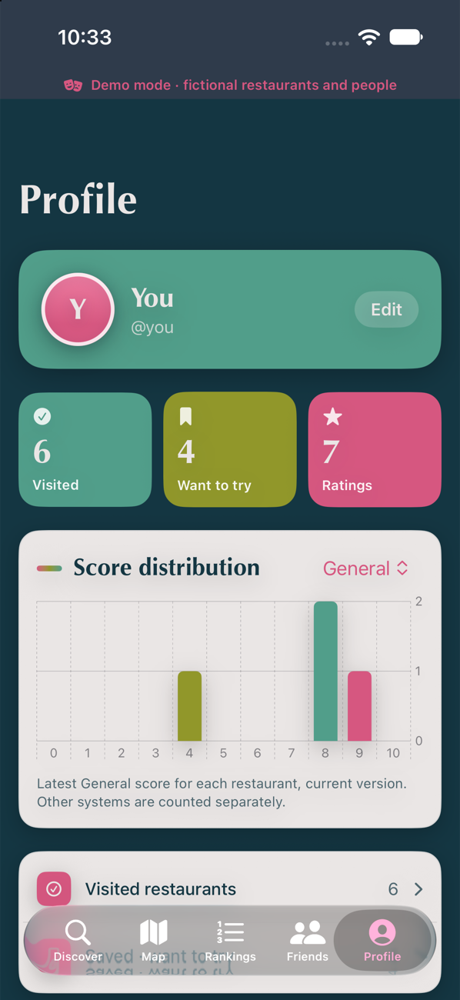
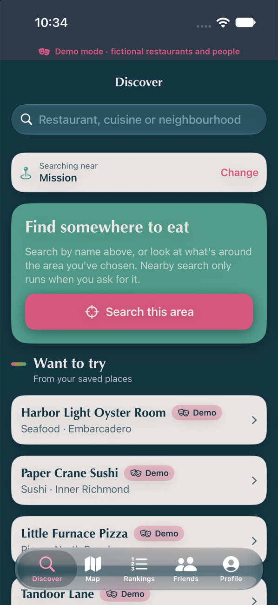

# Deconstructed

A native iPhone app for finding, logging and ranking restaurants, where every score out of 10 can be explained. You pick a ranking system, choose a described score for each of its criteria, and the app adds them up. There is nowhere to type an overall number.

<p>
  
  
  
  
</p>

Swift and SwiftUI, iOS 17+, iPhone only. Google Maps SDK and Places for search and maps, Supabase for accounts and data, Sign in with Apple.

## Where things stand

| | Status |
|---|---|
| Demo mode (no credentials) | Builds, runs and was walked through in the iOS 27 simulator on all five tabs |
| App logic | 40 unit tests pass |
| Database rules | 62 checks pass against the real migrations on Postgres 17 |
| Live Google and Supabase paths | **Compile against the current SDKs but have never been run.** No credentials were available, so nothing has talked to a real Google project or Supabase project |

Read [Not finished or not verified](#not-finished-or-not-verified) before planning a release.

## Run the demo

Open `Deconstructed.xcodeproj` in Xcode 16 or later, pick an iPhone simulator, and run. With no credentials the app starts in demo mode: 20 invented restaurants, seven invented people, and an in-memory backend that applies the same rules as the database. A ribbon on every screen and a badge on every listing say it is demo data. Demo edits persist between launches; Profile → Demo tools resets them and can simulate quota exhaustion or no network.

The first build downloads the Google and Supabase packages, which takes a few minutes.

## Going live

You need three values. None of them belongs in source control.

```bash
cp Config/Secrets.example.xcconfig Config/Secrets.xcconfig
```

`Config/Secrets.xcconfig` is git-ignored. Fill in `GOOGLE_MAPS_API_KEY`, `SUPABASE_PROJECT_HOST` (host only, no `https://`) and `SUPABASE_ANON_KEY`, and set `APP_BUNDLE_ID` and `DEVELOPMENT_TEAM` to yours. The app uses live services only when all three are present; otherwise it stays in demo mode and the sign-in screen lists what is missing.

**Google Cloud**

1. Enable *Maps SDK for iOS* and *Places API (New)*.
2. Create one API key. Restrict it to *iOS apps* with your bundle ID, and to those two APIs.
3. Set per-day quotas on the Places methods and a billing budget with alerts. [docs/google-api-usage.md](docs/google-api-usage.md) has the steps and the reasoning.

**Supabase**

1. Apply the migrations in `supabase/migrations`: paste them into the SQL editor in filename order, or run `supabase init`, `supabase link` and `supabase db push` (the folder has no `config.toml` yet).
2. Authentication → Providers → Apple: enable it and add your bundle ID as a client ID.
3. Deploy the account-deletion function: `supabase functions deploy delete-account`.
4. Database → Extensions: enable `pg_cron`, then schedule the daily purge of stale coordinates:
   ```sql
   select cron.schedule('purge-stale-restaurant-locations', '17 3 * * *',
                        'select app_private.purge_stale_restaurant_locations()');
   ```
   (The migration schedules this itself if `pg_cron` is already enabled when it runs.)

**Xcode**: add the *Sign in with Apple* capability under your team. The entitlement file is already in `Config/`.

Only the anon key ships in the app. The service-role key is used solely inside the Edge Function, from Supabase's own environment.

## How ranking systems work

- A **system** (General, Fine Dining, Fast Casual, or one you make) is a name plus criteria whose maximums total exactly 10. Each criterion describes every score from 0 to its maximum.
- A system's criteria live in **immutable versions**. Changing criteria publishes a new version; renaming does not. Every rating records the exact version it used and is never recalculated.
- The three **standard** systems are shared by everyone, which is what makes community averages meaningful. Editing one creates a personal copy and puts the standard one in your archive; you can restore it and keep both.
- A **rating revision** is one scoring of a visit. Changing scores, or re-rating with another system or version, adds a revision and marks the old one superseded. Only the active revision counts.
- **Rankings** default to one system and version. "All systems" labels each score with its system. Equal totals share a rank (1, 2, 2, 4) and are listed A–Z, with no hidden tiebreaker.
- **Community scores** are per standard system version, count each person once through their latest public visit, and are marked "Limited ratings" under five people. Custom systems are never averaged.

The starter rubrics are defined once, in `Deconstructed/Resources/StarterSystems.json`. The app reads that file; `python3 scripts/generate_seed.py` turns it into the database seed.

## Cost-sensitive Google flows

- Moving the map never searches. Nearby search runs only from **Search this area**.
- Autocomplete waits for a 350 ms pause and three characters, and uses one session token per search, closed by the details request when a suggestion is picked.
- Field masks are tiered: coordinate only for pins, six core fields for search and profiles, hours and contact only when the user asks. Photos and ratings are never requested.
- Opening a search result reuses what the search returned.
- Only place IDs are stored. Coordinates are cached for at most 30 days. Names are not stored at all, so lists fetch them once per launch. That is the app's main ongoing cost, and the doc below sizes it.
- Requests are counted and capped on the device (Profile → Search usage) and quota errors show a message with a retry.

Full table of requests, SKUs, prices, policy constraints and a monthly estimate: [docs/google-api-usage.md](docs/google-api-usage.md).

## Project layout

```
Config/                 xcconfig, Info.plist, entitlements. Secrets.xcconfig is git-ignored
Deconstructed/
  App/                  AppModel (state), DiscoveryModel (search rules), environment wiring
  Domain/               Models, ranking systems, scoring, ranking and community maths
  Services/             PlacesProvider and BackendService protocols, plus:
    Demo/               fictional places and an in-memory backend
    Google/             Places (New) client
    Supabase/           Supabase client
  DesignSystem/         theme, score bar, breakdowns, shared components
  Features/             one folder per screen
DeconstructedTests/     unit tests
supabase/
  migrations/           schema, row-level security, functions, standard systems
  functions/            delete-account Edge Function
  tests/                SQL rule tests and the script that runs them
docs/                   Google usage and cost notes, screenshots
```

Screens depend only on the two protocols in `Services/ServiceProtocols.swift`, so either provider can be replaced. The rating form is one view (`RatingForm`) generated from a system version; no system has its own form.

## Tests

```bash
xcodebuild test -project Deconstructed.xcodeproj -scheme Deconstructed \
  -destination 'platform=iOS Simulator,name=iPhone 17'
```

```bash
./supabase/tests/run.sh
```

The second needs Docker. It applies the migrations to a throwaway Postgres 17 and runs `supabase/tests/rules_test.sql` as different users.

| Requirement | App test | Database check |
|---|---|---|
| Every valid criterion combination gives the right total | all 300 combinations of the three starters | total computed from stored scores |
| Incomplete ratings don't affect rankings | drafts excluded; a draft re-rating leaves the submitted score in place | draft has no total; active rating still counts |
| Tied scores stay tied | ranks 1, 2, 2, 2, 5; order within a tie is A–Z only | – |
| Editing a visit updates rankings | order changes, old revision kept, delete removes it | edit supersedes, original scores kept |
| Community averages count each user once | three visits by one person count as one | latest public visit per person, per version |
| Systems and versions are never mixed | separate buckets; an edited copy leaves the standard average | one row per standard version; custom has none |
| Private reviews can't be read by others | stranger, follower and removed-follower cases | row-level security on visits, revisions and scores |
| Map movement doesn't trigger searches | 40 camera moves, zero provider calls | – |
| Location denied, network down, quota exhausted | manual area search; offline save fails cleanly and recovers; quota error then retry | – |
| Maximums total 10; scores in range; all answered | validator and backend | constraints, triggers and functions |
| Users edit only systems they own | standard and other people's systems refused | policies and function checks |
| Historical versions never change | version and rating identical after an edit | update triggers refuse changes |
| Client totals are not trusted | no total parameter exists | direct writes denied; trigger sets the total |

## Decisions and assumptions

- **Demo map.** Google requires Places content to be shown on a Google map, so the live app uses the Maps SDK. The demo has no key and shows only fictional places, so it uses Apple's MapKit. Both cluster pins.
- **The whole app is live or demo, never half.** A partial set of credentials falls back to demo so real search results are never mixed with fictional accounts.
- **Only public reviews feed community scores.** Followers-only and private reviews are excluded.
- **Following is open.** Anyone can follow anyone; "followers" visibility is protected by letting you remove a follower. There is no follow-request approval.
- **Saving a draft is always allowed**, including with a changed maximum awaiting review. Review is required before *publishing*.
- **Renaming a system doesn't create a version.** Ratings show the system's current name with the version they used.
- **New ratings use a system's latest version.** An existing rating can still be corrected under its own, older version.
- **Rankings use the latest completed visit, not the best one.** Under a system filter, that means the latest visit rated with that system and version.
- **Cuisine and area filters re-rank within the filter**, and only offer values the provider returned.
- **A completed visit removes the place from "Want to try."**
- **"Score all four criteria"** in the brief is read as "score every criterion of the chosen system". Fast Casual has three.
- **Look.** Every colour is one of the five in `Color-scheme.png` at its exact value (jet `143642`, blush rose `D65780`, alabaster `EAE6E5`, olive `91972A`, seagrass `519E8A`) or a transparency of one. Screens are solid jet; cards and sheets are alabaster. The one exception is the "Google Maps" attribution text in live mode, which follows Google's own styling. Headings and scores are set in Optima, which ships with iOS; body text is the system font. The app has this one appearance and does not follow the system light/dark setting. Small alabaster text on seagrass, olive and rose is below the usual 4.5:1 contrast guideline at these exact values.

## Not finished or not verified

**Never run for real**

- Sign in with Apple, every Supabase call, the Edge Function, Storage uploads, and all Google Places and Maps calls. The Swift compiles against supabase-swift 2.55 and the Google SDKs 11.2, and the SQL passes its tests, but the two halves have not met. Expect to fix query-shape or decoding mismatches in `SupabaseBackend.swift` on first contact.
- The SQL tests use a small shim for Supabase's `auth` and `storage` schemas. The Storage policies were applied but not exercised.

**Required before release**

- Your own Terms of Use and Privacy Policy, linked in the app. Google's policies require them and the About screen currently links only Google's.
- Revoking the Apple token when an account is deleted. The Edge Function deletes the user and their photos but does not call Apple's revoke endpoint, which App Review expects.
- An App Store privacy manifest review. None was added.

**Known gaps**

- No pagination. Rankings, the feed (capped at 60) and visit lists load everything, and long lists fetch every name.
- A photo uploaded to Storage whose database row then fails to insert is left orphaned.
- Saving a visit is several requests (visit, photos, rating), not one transaction. A failure midway can leave a visit saved without its rating; it shows up as a draft.
- No offline cache in live mode. Without a network, lists are empty until it returns.
- No follow requests, blocking or reporting.
- Profiles are readable by any signed-in user, including default visibility and default system.
- Reordering criteria uses Move up / Move down, not drag.
- English only. No UI tests; the walkthrough was manual and did not cover Dynamic Type at large sizes, VoiceOver or dark mode on a device, though the views use text styles, accessibility labels and adaptive colours throughout.
- The app icon is a generated placeholder.
